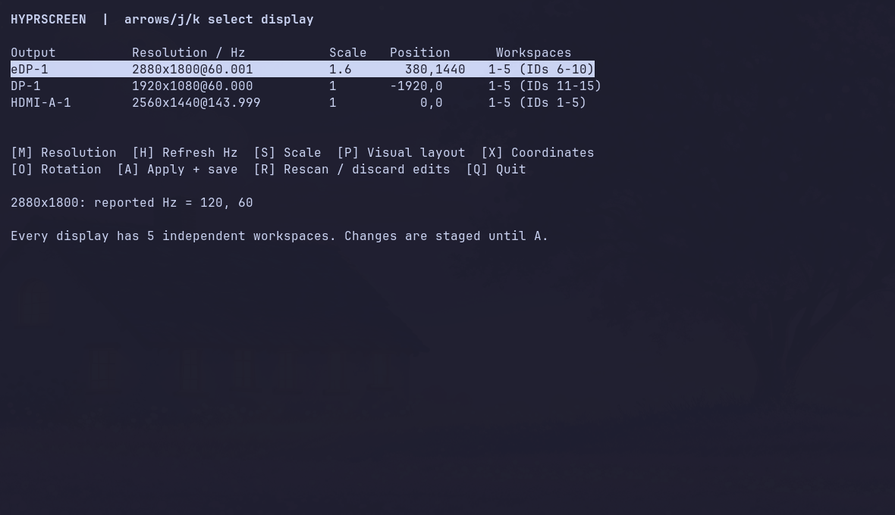
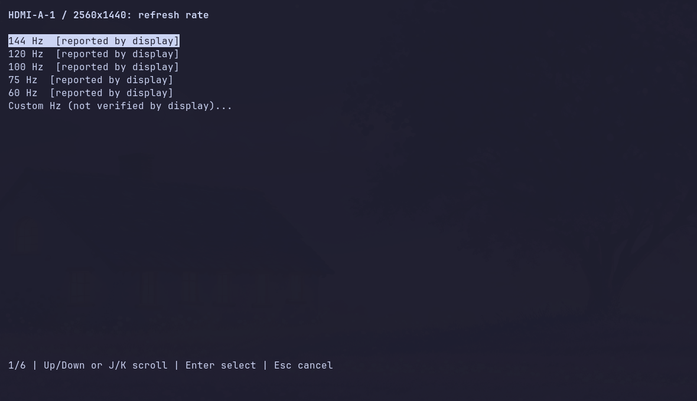
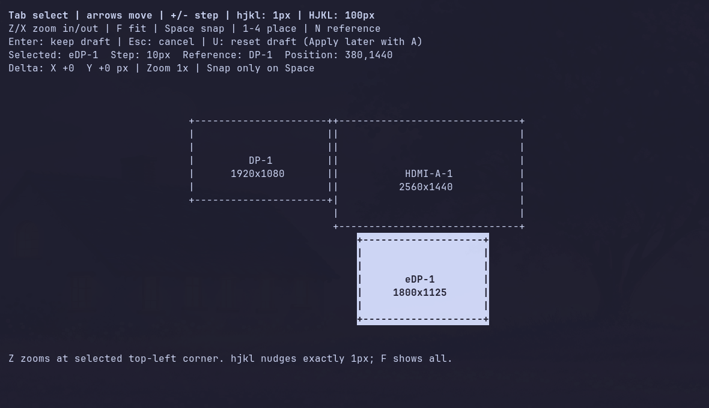

# Hyprscreen

TUI quản lý màn hình cho Hyprland: độ phân giải, tần số quét, scale, xoay màn và bố trí bằng sơ đồ. Mỗi màn có 5 workspace riêng.



## Yêu cầu

- Linux và Hyprland có **API cấu hình Lua** (`hl.monitor`, `hl.workspace_rule`, `hl.dsp`). Đã kiểm tra trên Hyprland 0.56.2 với cấu hình Lua của Omarchy.
- Python 3.10+ có `curses`; `hyprctl` trong PATH.
- Terminal ít nhất 80 cột × 24 dòng; nên dùng 110 × 30.

Không cần thư viện Python ngoài standard library. Phiên bản Hyprland chỉ dùng `hyprland.conf` chưa được hỗ trợ.

## Cài đặt

```bash
git clone https://github.com/endermeme/Hyprscreen.git
cd Hyprscreen
./install.sh
```

Bộ cài đặt lệnh vào `~/.local/bin/hyprscreen` và thêm mục **Hyprscreen** trong menu ứng dụng. Không cần sudo và không sửa cấu hình Hyprland lúc cài.

Nếu shell chưa tìm thấy lệnh, thêm dòng này vào cấu hình shell:

```bash
export PATH="$HOME/.local/bin:$PATH"
```

Trong phiên Hyprland, chạy:

```bash
hyprscreen init
```

Lệnh này đọc các màn đang kết nối và tạo cấu hình tại `~/.config/hyprscreen/` (hoặc `$XDG_CONFIG_HOME/hyprscreen/`). Thêm dòng `dofile(...)` mà lệnh in ra vào cuối `hyprland.lua`.

Trước khi nạp, sao lưu cấu hình hiện tại và bỏ các khai báo màn/workspace cũ bị trùng. File tích hợp của Hyprscreen quản lý các bộ workspace 5 slot và thay phím **Super + 1–5**, **Super + Shift + 1–5**, **Super + Ctrl + Alt + mũi tên**. Không cần thêm watcher riêng vào autostart; file Lua đã khởi động nó và ngăn chạy trùng.

```bash
hyprctl reload
hyprctl configerrors
hyprscreen
```

Muốn mở bằng **Super + Ctrl + Alt + M** trên Omarchy, thêm vào `bindings.lua`:

```lua
hl.unbind("SUPER + CTRL + ALT + M")
o.bind("SUPER + CTRL + ALT + M", "Hyprscreen", "omarchy-launch-tui hyprscreen")
```

Trên bản Hyprland khác, dùng launcher terminal của bạn để chạy `hyprscreen`.

## Chọn độ phân giải và Hz

Dùng mũi tên lên/xuống để chọn màn, **M** chọn độ phân giải, **H** đổi Hz của độ phân giải đang chọn. Mỗi độ phân giải có danh sách Hz riêng; menu có thể cuộn.



| Phím | Thao tác |
|---|---|
| M | Độ phân giải, sau đó tần số quét |
| H | Tần số quét |
| S | Scale |
| O | Xoay màn |
| P | Sơ đồ bố trí |
| X | Nhập tọa độ trực tiếp |
| R | Quét lại màn; bỏ thay đổi chưa áp dụng |
| A | Áp dụng và lưu |
| Q | Thoát |

Chế độ do màn báo được đánh dấu **reported by display**. Chế độ tự nhập không được coi là đã xác nhận hỗ trợ. Nếu adapter không đọc được EDID, ứng dụng chỉ có thể hiện những chế độ driver báo; có thể nhập Custom để thử với cơ chế khôi phục bên dưới.

## Sắp xếp màn hình

Bấm **P** để mở sơ đồ. Kích thước hình dùng độ phân giải sau scale, không phải kích thước vật lý của màn.



| Phím | Thao tác |
|---|---|
| Tab | Chọn hình màn khác |
| Mũi tên | Di chuyển; mặc định 10 pixel |
| − / + | Chọn bước 1, 2, 5, 10, 20, 50, 100, 200 hoặc 500 pixel |
| h / j / k / l | Nhích 1 pixel: trái / xuống / lên / phải |
| H / J / K / L | Dịch nhanh 100 pixel |
| Z / X | Phóng to quanh góc trên trái của màn đang chọn / thu nhỏ |
| F | Xem toàn bộ bố trí |
| Space | Căn sát mép màn bên cạnh |
| N | Đổi màn tham chiếu |
| 1 / 2 / 3 / 4 | Đặt trái / phải / trên / dưới màn tham chiếu, căn giữa |
| U | Đặt lại bản nháp |
| Enter / Esc | Giữ / hủy bản nháp |

Không tự hút mép khi di chuyển. Với chỉnh sửa rất nhỏ, dùng zoom và xem tọa độ **Position**, độ dịch chuyển **Delta**.

Bấm **Enter** để về màn chính, **A** để áp dụng, rồi **Y** trong 20 giây để giữ cấu hình. Không xác nhận thì tự khôi phục. Tiến trình khôi phục chạy riêng, kể cả khi terminal đóng.

## Workspace và cắm/rút màn

- Mỗi cổng kết nối được cấp một bộ 5 workspace; ID được lưu qua các lần chạy.
- **Super + 1–5** chọn workspace trên màn có con trỏ.
- **Super + Shift + 1–5** chuyển cửa sổ vào workspace trên màn có con trỏ.
- **Super + Ctrl + Alt + mũi tên** chuyển cửa sổ sang màn liền kề theo hướng. Không có màn theo hướng đó thì không làm gì.
- Khi rút màn khoảng 5 giây, cửa sổ được dồn về slot tương ứng trên laptop hoặc màn còn lại. Khi cắm lại, trả các cửa sổ chưa bị bạn chuyển đi về chỗ cũ.

Cấu hình được nhớ theo **cổng**, không theo serial màn. Nếu thay màn khác vào cùng cổng, hãy chọn lại chế độ phù hợp. Việc ghi nhớ vị trí cửa sổ khi rút màn chỉ tồn tại trong phiên đăng nhập.

Thanh workspace của desktop vẫn dùng plugin riêng của desktop đó. Hyprscreen không cài hay sửa plugin thanh trạng thái; ID nội bộ có thể hiện thành 6–10, 11–15... thay vì 1–5.

## Cập nhật và gỡ bỏ

```bash
cd Hyprscreen
git pull --ff-only
./install.sh
```

Cấu hình đã lưu được giữ lại. Khi gỡ, bỏ dòng `dofile(...)` đã thêm, khôi phục cấu hình màn/workspace và phím tắt cũ, rồi đăng nhập lại. Sau đó có thể xóa `~/.local/bin/hyprscreen`, `~/.local/share/applications/hyprscreen.desktop` và `~/.config/hyprscreen/`.

## Kiểm tra

```bash
python3 -m unittest discover -s tests -v
```

Các bài kiểm tra dùng dữ liệu giả cho cắm/rút màn, khôi phục cấu hình, chọn Hz và di chuyển sơ đồ; không đổi bố trí màn thật.

Giấy phép: [Unlicense](LICENSE).
